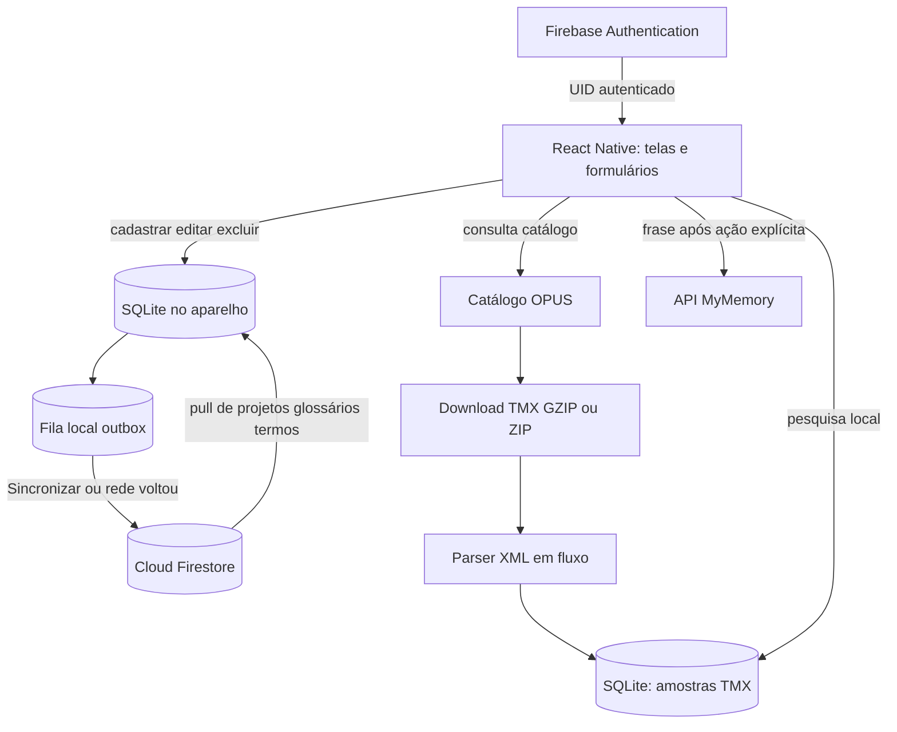

# Guia de apresentação e defesa técnica do Léxica Mobile

Este guia explica o aplicativo, os requisitos atendidos, a configuração do Firebase, o armazenamento offline, a sincronização e as APIs. Ele serve para preparar a demonstração em grupo e as respostas individuais. Use-o junto com o código: conhecer os arquivos e conseguir apontar o fluxo durante a apresentação ajuda a defender as decisões técnicas.

## 1. Resumo do projeto

O **Léxica Mobile** é um caderno de trabalho para tradutores. Ele organiza projetos de tradução, glossários e decisões terminológicas. O aplicativo foi construído com React Native e Expo. Cada alteração é gravada primeiro no SQLite do aparelho; quando existe uma conta Firebase autenticada e a conexão está disponível, o usuário pode sincronizar os registros com o Cloud Firestore. O app também consulta o catálogo OPUS, importa uma amostra TMX limitada para uso offline e oferece uma consulta online separada pelo MyMemory.

### Explicação curta para abrir a apresentação

> “Nosso aplicativo ajuda tradutores a organizar projetos, glossários e termos. Ele funciona primeiro no aparelho com SQLite, usa Firebase Authentication e Firestore para a conta e sincronização, e integra fontes de tradução: o OPUS para importar uma amostra TMX e pesquisá-la offline, e o MyMemory para uma consulta online explícita.”

### Requisitos do enunciado e onde demonstrá-los

| Exigência | Como aparece no Léxica | Demonstração |
|---|---|---|
| React Native | App Expo/React Native, com telas e componentes nativos | Abrir no Expo Go em um celular |
| Três CRUDs distintos | Projetos, Glossários e Termos | Criar, consultar, editar e excluir um item em cada aba |
| Firebase Authentication | Cadastro e login por e-mail e senha | Criar uma conta ou entrar com uma conta existente |
| Firestore | Subcoleções privadas por UID | Sincronizar e mostrar o documento no Console Firebase |
| SQLite | Banco local do aparelho | Criar/editar enquanto estiver sem conexão |
| Sincronização | Fila local pendente enviada ao Firestore | Reconectar e observar o estado “Na nuvem” |
| API externa pertinente | Catálogo OPUS/TMX e consulta MyMemory | Consultar/importar OPUS; pesquisar uma frase no MyMemory |

O enunciado também prevê avaliação individual. A nota de cada integrante depende de conseguir explicar o funcionamento, portanto todos devem estudar o fluxo e o código, mesmo que dividam a apresentação.

## 2. Como executar

### Requisitos

- Node.js 24 ou superior e npm.
- Expo Go instalado no Android ou iOS.
- Computador e celular na mesma rede Wi-Fi, normalmente.
- Para os recursos de nuvem, um projeto Firebase configurado e os cinco valores de configuração no arquivo `.env` local.

### Iniciar o aplicativo

Na pasta do repositório:

```powershell
npm ci
npm start
```

Leia o QR code com o Expo Go. Se o Metro Bundler já estava aberto antes de criar ou alterar `.env`, pare-o com `Ctrl+C` e inicie `npm start` outra vez: a configuração pública do Firebase é lida quando o bundle é iniciado.

`npm run export:android` exporta o bundle JavaScript para Android. **Esse comando não gera um APK instalável.** O enunciado exige um aplicativo mobile em React Native e demonstração; o fluxo documentado aqui usa Expo Go no celular.

### Configurar Firebase pela primeira vez

1. Crie um projeto no Firebase Console.
2. Em **Authentication**, habilite o provedor **E-mail/senha**.
3. Crie o banco **Cloud Firestore**.
4. Registre um app Web nas configurações do projeto para obter a configuração do SDK.
5. Copie `.env.example` para `.env` e preencha `EXPO_PUBLIC_FIREBASE_API_KEY`, `EXPO_PUBLIC_FIREBASE_AUTH_DOMAIN`, `EXPO_PUBLIC_FIREBASE_PROJECT_ID`, `EXPO_PUBLIC_FIREBASE_APP_ID` e `EXPO_PUBLIC_FIREBASE_MESSAGING_SENDER_ID`.
6. Com o Firebase CLI instalado e autenticado, associe o projeto à pasta e publique as regras:

   ```powershell
   firebase login
   firebase use --add
   firebase deploy --only firestore:rules
   ```

O `firebase.json` já aponta para `firestore.rules`. O `.env` é ignorado pelo Git. A configuração Web identifica o projeto cliente; não coloque no app uma chave privada ou JSON de conta de serviço. A proteção dos dados é aplicada pelas Firebase Security Rules e pela autenticação.

## 3. Como usar o aplicativo

### Conta Firebase e demonstração local

Na primeira tela, a pessoa pode criar uma conta ou entrar. Se quiser apenas conhecer a interface sem configurar nuvem, toque em **Abrir demonstração com exemplos**. Na primeira entrada em um aparelho sem registros de demonstração, esse modo carrega no SQLite local um projeto, um glossário e três termos jurídicos ilustrativos. Os exemplos podem ser editados e excluídos, mas não são enviados ao Firestore. Se o aparelho já tiver dados de demonstração, eles são preservados e não são semeados novamente.

Para demonstrar Authentication, Firestore e sincronização, use a conta Firebase. O modo de demonstração local tem outro identificador (`demo-local`) e é explicitamente local-only; os exemplos não aparecem na conta Firebase.

### Projetos

Organize um trabalho por nome, cliente, idiomas, área e notas. Os campos nome, cliente, idiomas e área são obrigatórios.

### Glossários

Registre vocabulário aprovado por cliente e par de idiomas. O glossário mantém o nome, cliente, idiomas e descrição.

### Termos

Registre o texto de origem e a tradução aprovada, idiomas, projeto e glossário relacionados, categoria, contexto e fonte opcional. São exemplos de conteúdo que um tradutor pode consultar durante outros trabalhos.

Cada aba oferece **+ Novo**, lista de registros, **Editar** e **Excluir**. Excluir pede confirmação e marca o registro como excluído para que a exclusão também possa ser sincronizada.

### Memórias de tradução

Na aba **OPUS** há três áreas diferentes:

1. **Buscar uma frase (MyMemory):** envia a frase à API MyMemory somente depois que a pessoa toca no botão. Retorna até cinco sugestões online; o app não grava essas respostas como termos.
2. **Suas amostras offline:** pesquisa frases nas amostras TMX que já foram importadas para o SQLite. Essa pesquisa é local e pode funcionar sem internet.
3. **Catálogo OPUS:** consulta as coleções disponíveis para o par de idiomas. Use `en` como origem e `pt` como destino para o catálogo OPUS. A coleção é opcional; pode-se escrever, por exemplo, `Europarl` ou `DGT`.

Para importar uma base, escolha **Importar amostra para uso offline**. O botão **Abrir arquivo TMX no OPUS** abre o arquivo integral no site/navegador e pode apresentar um download grande; ele não é o botão de importação do app.

## 4. Arquitetura em uma visão



Uma separação importante: os registros de Projetos/Glossários/Termos são sincronizados com Firestore. As amostras OPUS/TMX são mantidas no SQLite do aparelho e **não** são sincronizadas para a conta Firestore.

## 5. Firebase em detalhe

### 5.1 Configuração e inicialização

`src/firebase.ts` lê cinco variáveis `EXPO_PUBLIC_FIREBASE_*` do ambiente e só inicializa Firebase quando todas existem. Isso permite que o projeto abra em modo local sem tentar acessar um projeto Firebase inexistente.

Quando a configuração está completa:

1. `initializeApp` cria a instância Firebase, ou `getApp` reutiliza a que já existe.
2. `initializeAuth` configura Firebase Authentication com persistência React Native em `AsyncStorage`.
3. `getFirestore` cria o cliente Firestore.

O `AsyncStorage` preserva a sessão no dispositivo entre reinicializações. Quando o SDK já tinha sido inicializado, o código usa `getAuth` como fallback em vez de tentar inicializar a mesma instância duas vezes.

### 5.2 Cadastro, login e controle de acesso

`src/screens/AuthScreen.tsx` oferece cadastro e login por e-mail/senha. O formulário verifica e-mail preenchido e senha com pelo menos seis caracteres. Erros comuns, como e-mail já usado e credenciais incorretas, recebem mensagens legíveis.

`App.tsx` observa `onAuthStateChanged`. Enquanto a sessão está sendo recuperada, mostra carregamento. Sem usuário, mostra AuthScreen; com usuário, monta as abas do app. O identificador `user.uid` passa a ser o proprietário dos registros locais e é usado para formar os caminhos Firestore.

O modo **Demonstração com exemplos** não é um login falso: ele não cria usuário Firebase, não comprova Authentication e não grava no Firestore. Para apresentar autenticação, use a conta Firebase.

### 5.3 Organização dos dados Firestore

O formato usado pelo app é:

```text
users/{uid}/projects/{recordId}
users/{uid}/glossaries/{recordId}
users/{uid}/terms/{recordId}
```

Cada documento contém os campos da entidade e metadados como:

| Campo | Uso |
|---|---|
| `id` | ID do documento; precisa corresponder ao `{recordId}` do caminho |
| `userId` | UID proprietário adicionado antes do envio |
| `createdAt` | Data/hora ISO em que o registro foi criado |
| `updatedAt` | Data/hora ISO da última alteração |
| `deletedAt` | `null` para ativo ou data ISO para tombstone de exclusão |

Exemplo conceitual, sem dados pessoais:

```text
users/UID/projects/UUID
  id: UUID
  userId: UID
  name: "Manual do produto"
  sourceLang: "en"
  targetLang: "pt-BR"
  deletedAt: null
```

O documento pai `users/{uid}` não precisa existir para as subcoleções funcionarem. O Firestore permite que uma subcoleção e seus documentos existam sem um documento pai materializado; por isso o Console pode mostrar um aviso no pai enquanto os documentos em `projects`, `glossaries` ou `terms` estão salvos.

### 5.4 Regras de segurança

`firestore.rules` aplica quatro verificações principais:

- É preciso estar autenticado (`request.auth != null`).
- O UID autenticado precisa ser igual ao `{userId}` no caminho.
- Ao criar, `request.resource.data.userId` precisa ser o UID e o campo `id` precisa corresponder ao ID do documento.
- Ao atualizar ou excluir, o documento existente precisa pertencer ao UID. Na atualização, o novo conteúdo também precisa preservar `userId` e `id`.

Isso impede que um usuário autenticado leia ou altere os registros de outro UID pelos caminhos usados pelo app. As regras verificam propriedade e consistência de IDs, mas não validam todo o esquema de campos nem limitam a wildcard a apenas três nomes de coleção. A tela valida campos obrigatórios e idiomas; validação de interface não substitui Security Rules.

### 5.5 O que acontece ao sincronizar

O botão **Sincronizar** chama `runSync()` em `App.tsx`. Além do toque manual, a rotina tenta sincronizar ao detectar internet disponível e quando o app volta ao primeiro plano.

`src/sync.ts` executa a sincronização em duas fases:

1. **Pull:** lê cada subcoleção do usuário (`projects`, `glossaries`, `terms`) com `getDocs` e mescla os documentos no SQLite.
2. **Push:** lê até 100 operações pendentes da outbox em ordem. Para cada operação, usa `setDoc` no caminho do usuário e acrescenta `userId`. Só remove a operação da fila depois que o envio ao Firestore termina com sucesso.

Depois, a tela atualiza os rótulos: **Sincronizando…**, **Sincronizado**, **Alterações aguardando envio**, **Offline · salvo no aparelho** ou **Falha na sincronização**. Em uma falha de rede, as operações que não foram confirmadas permanecem no SQLite para uma nova tentativa.

### 5.6 Política simples de conflitos

Se existe uma alteração local pendente para o mesmo registro, o pull remoto não a substitui: a alteração local fica na frente e será enviada. Se não existe pendência local, o valor remoto recebido atualiza o SQLite. Não há mesclagem por campo nem resolução colaborativa de conflitos; esta é uma política simples para o escopo do trabalho.

Exclusões são **soft delete**: o app define `deletedAt` e oculta o item da lista local. A tombstone é enviada ao Firestore como documento atualizado; ela não é uma exclusão física (`deleteDoc`). Isso preserva a informação de exclusão para a sincronização entre dispositivos.

## 6. SQLite e funcionamento sem internet

`src/database.ts` abre `lexica-mobile.db` com Expo SQLite e configura WAL e chaves estrangeiras. Os principais dados são:

| Tabela | Conteúdo |
|---|---|
| `records` | Registros por proprietário, entidade e ID; guarda o JSON, datas, tombstone e estado de sincronização |
| `outbox` | Alterações ainda não confirmadas pela nuvem; uma entrada por proprietário/entidade/registro |
| `tm_datasets` | Metadados das amostras TMX importadas |
| `tm_pairs` | Segmentos de origem e destino para busca local |
| `app_metadata` | Marcador para carregar a amostra do modo demonstração uma única vez |

Ao salvar ou editar, a tela grava registro e outbox dentro de uma transação SQLite. Ao excluir, grava a tombstone pelo mesmo mecanismo. Isso significa que a alteração já fica persistida no aparelho antes de depender da rede.

O proprietário faz parte da chave primária local. A conta Firebase usa o UID como `owner_id`; o modo de demonstração usa `demo-local`. Assim os registros do exemplo local não se misturam com os da conta autenticada.

### Fluxo para demonstrar offline

1. Entre com a conta Firebase e crie ou edite um termo enquanto online.
2. Toque em **Sincronizar** e confira no Firestore.
3. Desligue Wi-Fi/dados móveis.
4. Edite outro termo. Ele continua aparecendo no app, com estado pendente/offline.
5. Reative a conexão. O listener de rede tenta sincronizar; se necessário, toque em **Sincronizar**.
6. Confirme **Na nuvem/Sincronizado** no app e a alteração no Console.

Importante: no modo com conta, a gravação inicial é local e o app oferece sincronização manual. Não prometa que todo toque em “Salvar” dispara imediatamente um `setDoc`; para a apresentação online, toque em **Sincronizar** ou reconecte a rede.

## 7. Integrações de tradução

### 7.1 OPUS e TMX

`src/opus.ts` consulta o endpoint público OPUS API com `source`, `target`, `preprocessing=tmx`, `version=latest` e, se preenchido, `corpus`. O catálogo devolve coleções, versão, par de idiomas, estimativa e URL de download. O app mostra até 25 opções.

Use `en` e `pt` no catálogo OPUS. `pt-BR` é uma região válida nos formulários do Léxica, mas o catálogo OPUS indexa português genérico como `pt`; essa diferença foi corrigida no padrão da aba OPUS.

Ao tocar em **Importar amostra para uso offline**, o app:

1. Aceita somente HTTPS e URLs nos hosts previstos do OPUS (`opus.nlpl.eu` e `object.pouta.csc.fi`, com caminho de objeto OPUS validado).
2. Lê a resposta em fluxo, sem guardar o TMX inteiro em memória nem salvar um arquivo completo no Downloads.
3. Descomprime GZIP ou ZIP com `fflate`, se necessário.
4. Passa o XML progressivamente ao parser `saxes`.
5. Para ao obter a amostra solicitada e aplica limites de segurança: 25 MiB comprimidos e 32 MiB descompactados. ZIP com mais de um TMX é recusado.
6. Ao alcançar a quantidade solicitada, cancela a leitura de rede — inclusive quando a origem é um ZIP — e salva os pares aceitos em `tm_pairs` e os metadados em `tm_datasets` dentro do SQLite.

TMX organiza unidades `<tu>` com variantes `<tuv xml:lang="…">` e segmentos `<seg>`. O parser em `src/tmx-parser.ts` identifica exatamente um segmento de origem e um de destino com os idiomas selecionados. Entidades XML são decodificadas; placeholders inline como `<ph>` não são usados como palavras; XML malformado e DTD interna são recusados. Os limites de profundidade, variantes, tamanho de unidade e segmento evitam entradas descontroladas.

O OPUS é uma **fonte de corpus**, não uma API de tradução instantânea. A pesquisa local encontra texto de origem exato ou parcial nas amostras importadas, sem acentos e sem diferença entre maiúsculas/minúsculas; retorna até oito pares. A amostra contém apenas um trecho inicial do arquivo e não representa o corpus inteiro.

Um arquivo integral pode ter centenas de megabytes. **Não use “Abrir arquivo TMX no OPUS” para importar**; isso abre o arquivo completo no navegador. Use **Importar amostra para uso offline**, que aplica os limites acima.

### 7.2 MyMemory

`searchMyMemory()` faz uma requisição GET à API pública MyMemory quando a pessoa toca **Buscar correspondências**. Ela envia a frase e o par de idiomas, valida o limite de 500 bytes no formulário e mostra no máximo cinco traduções e a pontuação retornada pela API.

Essa consulta exige internet e compartilha aquela frase com o serviço MyMemory. A frase não é salva automaticamente como um termo. O usuário decide o que aproveitar e deve revisar contexto, qualidade e licença.

### 7.3 Como diferenciar as duas fontes na apresentação

| Recurso | OPUS | MyMemory |
|---|---|---|
| O que consulta | Catálogo de coleções de corpus | Correspondências para uma frase |
| O que baixa/retorna | Arquivo TMX da coleção escolhida | Até cinco sugestões de tradução |
| Como fica disponível offline | Amostra importada é guardada no SQLite | A consulta em si não fica disponível offline |
| Quando envia texto digitado | Não envia a frase da pesquisa local ao OPUS | Envia a frase escolhida ao tocar no botão |

## 8. Validação, erros e segurança

`src/validation.ts` valida campos obrigatórios por entidade, impede idiomas de origem e destino iguais, aceita `en`, `pt`, `pt-BR`, `es`, `fr`, `de`, `it` e `ja`, impõe limites de comprimento e restringe a fonte a referência textual ou URL HTTP/HTTPS.

As mensagens de erro de login e sincronização são apresentadas sem apagar o conteúdo salvo localmente. A senha nunca é gravada na tabela SQLite pelo código da aplicação. Não coloque credenciais de conta de serviço no repositório ou no bundle mobile.

### Limitações que é melhor explicar com transparência

- O projeto é apresentado no Expo Go; não há APK de produção gerado pelo comando de exportação.
- Firebase real precisa de `.env`, provedor e Firestore configurados, além das regras publicadas.
- A outbox processa lotes de até 100 operações por sincronização.
- A sincronização não é um sistema colaborativo com resolução avançada de conflito; usa pendência local como prioridade e, sem pendência, aplica o remoto.
- O modo de demonstração é apenas local e não comprova Firebase.
- A amostra TMX é limitada e local; a licença e a qualidade variam por corpus.
- Os exemplos jurídicos são ilustrativos de terminologia, não parecer ou orientação jurídica.

## 9. Roteiro sugerido para a apresentação

1. **Apresente o problema e a solução:** tradutores precisam organizar trabalhos e manter escolhas terminológicas consistentes.
2. **Mostre os três CRUDs:** crie um projeto, um glossário e um termo; edite um e exclua outro.
3. **Mostre Authentication:** indique o usuário autenticado e explique que o UID separa os dados.
4. **Mostre Firestore:** toque **Sincronizar**, abra `users/{UID}` e mostre os documentos nas três subcoleções.
5. **Mostre offline:** desligue a rede, edite um termo, confirme que continua no SQLite; reconecte e sincronize.
6. **Mostre OPUS:** consulte `en` → `pt`, importe uma amostra e pesquise um trecho local; repita com a rede desligada.
7. **Mostre MyMemory:** consulte uma frase online e explique que a pessoa escolhe quando enviá-la.
8. **Feche com limites conscientes:** apenas amostra do corpus, revisão humana das traduções e política simples de conflitos.

Divida quem opera o celular, quem explica Firebase, quem explica SQLite/sincronização e quem explica OPUS/TMX. Ainda assim, cada integrante deve estar pronto para responder sobre qualquer parte, pois as perguntas são individuais.

## 10. Perguntas prováveis do professor

### “Por que vocês usam SQLite e Firestore ao mesmo tempo?”

SQLite permite continuar trabalhando quando o celular está sem internet e dá acesso rápido aos registros locais. Firestore guarda a cópia da conta na nuvem. A outbox registra o que ainda falta enviar.

### “O que acontece quando o usuário salva sem internet?”

O app grava o registro e uma operação pendente no SQLite dentro de uma transação. A tela mantém o conteúdo local. Quando a rede volta, a sincronização tenta enviar a outbox; também existe o botão manual.

### “Como vocês sabem de quem é cada registro?”

Depois do login, o UID do Firebase é usado no caminho `users/{uid}/…` e como proprietário local. As regras comparam esse UID ao usuário autenticado antes de permitir operações.

### “Onde ficam as traduções importadas do OPUS?”

Os pares TMX ficam nas tabelas locais `tm_datasets` e `tm_pairs`. Eles não são enviados ao Firestore. A busca offline consulta essas tabelas.

### “OPUS traduz a frase que eu digito?”

Não. No app, OPUS oferece o catálogo de corpora e arquivos TMX que podem virar amostras locais. Para uma consulta de frase online, a tela usa MyMemory, que é outra API.

### “Por que baixar apenas mil pares?”

Corpora podem ser muito grandes. A amostra limitada reduz dados, tempo e memória no celular, mas deixa explícito que não representa o corpus inteiro.

### “O que é TMX?”

Translation Memory eXchange: um formato XML para intercambiar unidades de tradução. Uma unidade (`tu`) agrupa variantes (`tuv`) e segmentos (`seg`) identificados por idioma.

### “Como evitam enviar tudo ao Firestore toda vez?”

A sincronização primeiro puxa os documentos da conta e depois envia as operações pendentes guardadas na outbox. Após cada `setDoc` bem-sucedido, remove aquela operação da fila e marca o registro como sincronizado.

### “E se o envio falhar no meio?”

Operações já confirmadas podem ser removidas da fila; as não confirmadas continuam pendentes. Uma nova tentativa pode ser acionada manualmente, ao voltar a conexão ou ao reabrir o app.

### “Como vocês resolvem duas pessoas editando o mesmo registro?”

Não há merge por campo. Se este aparelho tem uma mutação pendente, ela vence o pull remoto para aquele ID e será enviada. Sem mutação pendente, o documento remoto atualiza o SQLite. É uma política simples, não uma sincronização colaborativa avançada.

### “Por que a exclusão aparece no Firestore?”

Ela é registrada como tombstone: `deletedAt` recebe uma data e o item some da lista local. A tombstone sincroniza como atualização para que outro dispositivo saiba que aquele registro foi removido. O documento não é apagado fisicamente.

### “A chave do Firebase dentro do app não é perigosa?”

O app cliente precisa da configuração pública do projeto para falar com Firebase. Ela não deve ser confundida com chave privada de conta de serviço. A autorização dos documentos vem da sessão e das Firestore Security Rules.

### “Os exemplos jurídicos são dados de um cliente?”

Não. São dados fictícios/ilustrativos de demonstração local. O modo exemplo usa `demo-local`, avisa que não sincroniza e não representa orientação jurídica.

### “Como vocês testaram?”

O repositório tem testes de validação dos formulários e do parser TMX, além de checagem TypeScript e exportação do bundle Android. Na apresentação, complementem isso com o teste real no celular: login, Firestore, offline, retorno da rede e API.

## 11. Mapa dos arquivos principais

| Arquivo | Responsabilidade |
|---|---|
| `App.tsx` | Sessão, estado de rede, sincronização e abas |
| `src/screens/AuthScreen.tsx` | Cadastro/login e entrada no modo demonstração |
| `src/screens/CrudScreen.tsx` | Formulário reutilizado para os três CRUDs |
| `src/definitions.ts` | Campos e textos de Projetos, Glossários e Termos |
| `src/validation.ts` | Regras de validação e conversão de formulários em registros |
| `src/database.ts` | SQLite, outbox, tombstones e amostras TMX |
| `src/sync.ts` | Pull e push entre subcoleções Firestore e SQLite |
| `src/firebase.ts` | Configuração Firebase, Auth persistente e Firestore |
| `firestore.rules` | Isolamento de documentos por UID |
| `src/opus.ts` | Catálogo OPUS, importação limitada e consulta MyMemory |
| `src/tmx-parser.ts` | Parser XML TMX em fluxo |
| `src/demo-data.ts` | Conteúdo jurídico ilustrativo para o modo local |

## 12. Comandos de revisão do projeto

Na raiz do repositório:

```powershell
npm run check
npm test
npm run export:android
```

`check` executa TypeScript sem gerar arquivos. `test` executa os testes unitários existentes. `export:android` confirma que o bundle Android é empacotado; ele não substitui um teste de apresentação no aparelho e não gera um APK de produção.

## 13. Referências oficiais

- [Firebase Authentication com e-mail e senha](https://firebase.google.com/docs/auth/web/password-auth)
- [Configuração do Firebase para app JavaScript](https://firebase.google.com/docs/web/setup)
- [Cloud Firestore e Security Rules](https://firebase.google.com/docs/firestore/security/get-started)
- [Publicar regras do Firebase](https://firebase.google.com/docs/rules/manage-deploy)
- [OPUS API](https://opus.nlpl.eu/opusapi)
- [Formatos de download OPUS e TMX](https://opus.nlpl.eu/download-formats)
